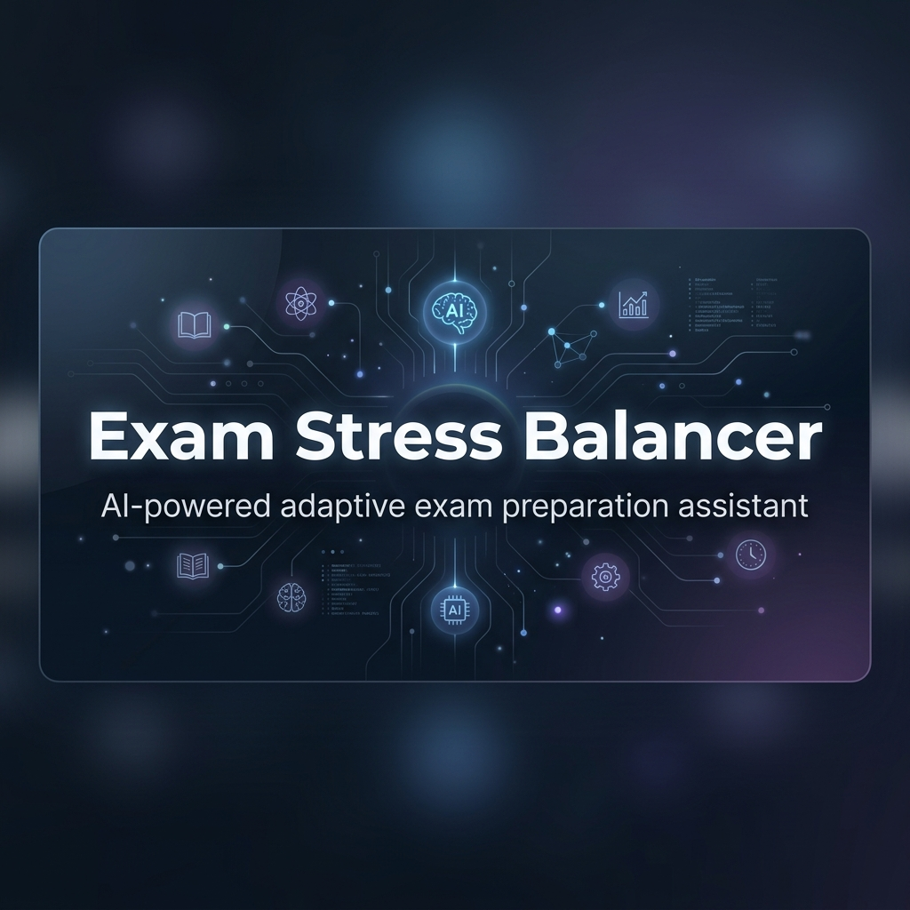
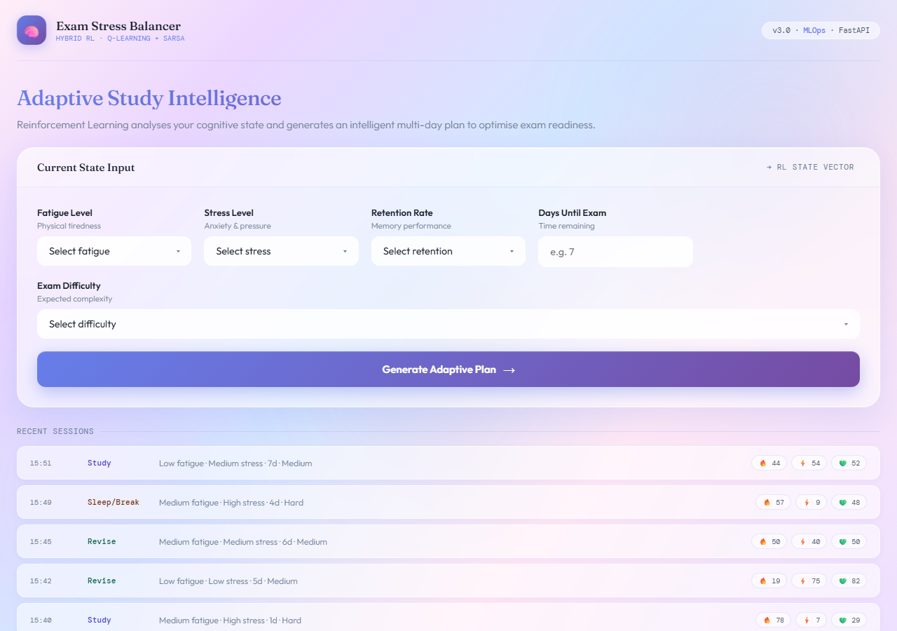
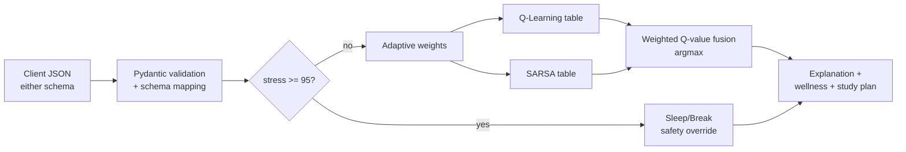
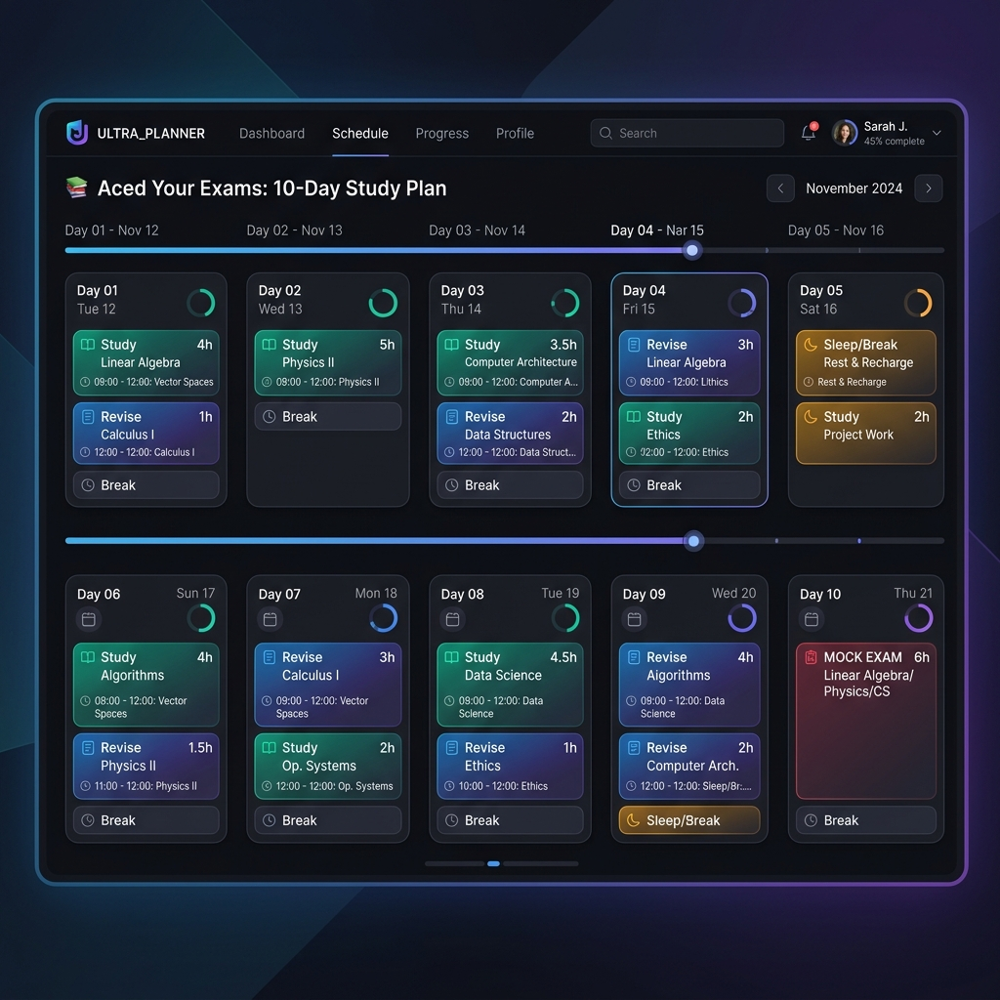
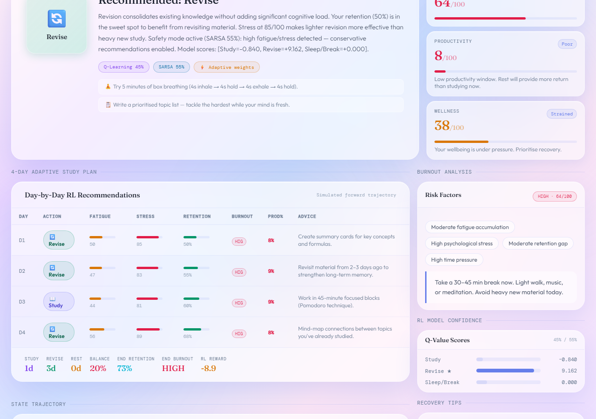

<div align="center">
  
</div>

# Exam Stress Balancer — Hybrid RL + MLOps

> A production-style ML service that tells a student **what to do right now** (Study, Revise or Rest) and **why**, by fusing two reinforcement-learning agents behind a hard safety guardrail.

[](https://github.com/Ravva-78/exam-stress-balancer-mlops/actions/workflows/ci.yml)
[](https://exam-stresss-balancer.onrender.com)
[](LICENSE)
[](https://python.org)
[](https://fastapi.tiangolo.com)
[](https://mlflow.org)
[](https://dvc.org)
[](https://docker.com)

**[Live demo](https://exam-stresss-balancer.onrender.com)** (free tier — the first request may take ~30 s to wake) · **[API docs](docs/api.md)** · **[Architecture](docs/architecture.md)** · [](https://render.com/deploy?repo=https://github.com/Ravva-78/exam-stress-balancer-mlops)



## Why this project

Most "study planners" are static timetables. This one treats exam prep as a sequential decision problem: the right move depends on fatigue, stress, retention, days left and difficulty, and pushing too hard backfires. It is built end-to-end — environment simulation, two RL algorithms, an explainable serving layer, reproducible training, tests and CI — to demonstrate how an RL model is actually *shipped*, not just trained in a notebook.

## Highlights

| Area | What's inside |
|---|---|
| **Reinforcement learning** | Tabular **Q-Learning** (off-policy) and **SARSA** (on-policy) trained on a custom stochastic student-simulation environment (243 discrete states, 3 actions) |
| **Hybrid decision engine** | Adaptive fusion of both agents: 60/40 by default, shifts to 45/55 toward SARSA under high fatigue/stress, and to 75/25 toward Q-Learning under high exam urgency |
| **Safety first** | Hard override: stress ≥ 95 bypasses the models and forces `Sleep/Break`; covered by tests and surfaced in the explanation |
| **Explainability** | Every response includes per-action Q-values from both agents plus a plain-English rationale |
| **Planning** | Forward-simulates a multi-day (up to 14 days) study plan with a balance score and state-trajectory chart |
| **Wellness analytics** | Burnout risk, productivity and wellness scores, urgency classification, recovery tips |
| **API design** | FastAPI + Pydantic v2; one endpoint accepts **two input schemas** (client-friendly and internal ML), with strict validation (422 on bad input) |
| **MLOps** | DVC pipeline (train → evaluate → baseline comparison → plots), MLflow experiment tracking, params in `params.yaml` |
| **Delivery** | Multi-stage Dockerfile + Compose (API + MLflow), Procfile for Render, GitHub Actions CI, 95 automated tests |

## How it works



Details (state bins, reward design, weighting rules) are in [docs/architecture.md](docs/architecture.md).

## Try it

```bash
curl -X POST https://exam-stresss-balancer.onrender.com/api/explain \
  -H "Content-Type: application/json" \
  -d '{"stress_level": "high", "hours_studied": 6, "days_until_exam": 3, "current_performance": 0.4}'
```

```json
{
  "recommended_action": "Revise",
  "adaptive_weights": {"q_learning": 0.45, "sarsa": 0.55},
  "explanation": "Revision consolidates existing knowledge without adding significant cognitive load. ... Safety mode active (SARSA 55%): high fatigue/stress detected — conservative recommendations enabled."
}
```

Other endpoints: `/api/predict`, `/api/study-plan`, `/api/burnout`, `/api/wellness`, `/api/history`, `/health`. Interactive Swagger UI is served at `/docs`.

<p>
  
  
</p>

## Run locally

```bash
git clone https://github.com/Ravva-78/exam-stress-balancer-mlops && cd exam-stress-balancer-mlops
python -m venv .venv && source .venv/bin/activate
pip install -r requirements.txt
uvicorn src.api.main:app --reload        # http://localhost:8000
```

**Docker** (API + MLflow UI): `docker compose up --build` → API on `:8000`, MLflow on `:5000`.

**Retrain / reproduce experiments:** edit `params.yaml`, then `dvc repro`; browse runs with `mlflow ui --port 5000`.

**Tests:** `pip install pytest httpx && pytest` (CI runs the same on every push).

## Project layout

```
src/
  api/          FastAPI app, dual-schema validation, hybrid inference, explanations
  rl/           student environment, Q-Learning & SARSA agents, state discretizer, study planner
  analytics/    burnout, productivity, wellness, urgency, adaptive weights
  training/ evaluation/ visualization/    DVC pipeline stages (MLflow-tracked)
tests/          API, RL core, analytics and utility tests
docs/           architecture + API reference
```

## Engineering notes & known limitations

Honest scope, so you know what this is and isn't:

- **Simulated data.** Policies are trained on a hand-designed simulator of student behaviour, not real student outcomes. It demonstrates the RL + MLOps workflow; it is **not** a validated psychological or medical tool, and shouldn't replace professional advice.
- **Tabular RL.** 243 discrete states keeps the policy inspectable; a function-approximation (DQN) variant is a natural next step.
- **Serving models are committed** (`models/q_learning.pkl`, `models/sarsa.pkl`) so the demo deploys without a DVC remote. The DVC `train` stage currently emits a single-algorithm artifact; unifying it with the two-table serving format is on the roadmap. Pickles should only be loaded from trusted sources.
- No built-in rate limiting or auth (see [SECURITY.md](SECURITY.md)); put a gateway in front for production use.

## Roadmap

- [ ] DVC stage that trains and exports both serving tables
- [ ] Per-user personalization with persisted history
- [ ] Offline policy evaluation against the baselines in `src/evaluation/`
- [ ] Container image publish from CI

## Author

Built by [**@Ravva-78**](https://github.com/Ravva-78) as an end-to-end ML engineering portfolio project (RL, MLOps, backend, UI). Feedback and issues welcome — see [CONTRIBUTING.md](CONTRIBUTING.md) and the [CHANGELOG](CHANGELOG.md).

## License

This project is licensed under the MIT License — see the [LICENSE](LICENSE) file for details.
